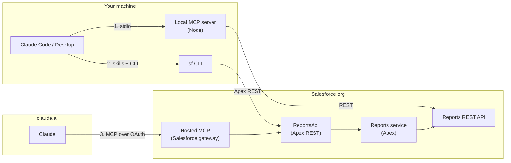

# salesforce-reports-mcp

Claude finds, builds, runs and saves Salesforce reports. You ask a question in plain words and get the answer, with the report behind it.

This repo is working software, and a demonstration. It takes one useful job, reports, and delivers it to Claude three ways, from a server on your laptop to a feature that lives inside Salesforce. Every design choice is written down with what it costs. Built by [Ben Nelsen](https://github.com/nelsben).

> **You:** List the report types I can build on, then build me an opportunity report grouped by stage without saving it.
>
> **Claude:** The org has 156 report types; here they are by category. Opportunities by stage: 8 open deals, $3,091,000. Negotiation/Review holds 3 of them and 39% of the value. Salesforce applied its default filters: close date this fiscal quarter, probability above 0. Nothing was saved. Want it across all close dates, or saved to your Private Reports?
>
> *claude.ai, through the MCP server hosted by Salesforce, signed in as the user ([rehearsal](docs/rehearsals/runner-hosted.md)).*

## What this repo shows

| Claim | Where to look | Evidence you can check |
| --- | --- | --- |
| **1. Three ways to connect Salesforce and Claude**, each with its own trade-offs | [Three ways to connect](#three-ways-to-connect) | One tool contract and result shape on every door (12 tools locally, 11 in the org); a [parity check](docs/decisions/0010-verification-by-parity.md) runs the same calls through two doors against a real org and compares them |
| **2. A useful feature added to Salesforce itself**, packaged the way an admin expects | [A feature inside Salesforce](#a-feature-inside-salesforce) | Three package directories; layered Apex with a CI test that fails if the layers leak; 65 Apex tests at 98% coverage |
| **3. Security, authentication and integration** done deliberately, per door | [Security and identity](#security-and-identity) | A different identity per door, a per-user JWT named credential with no stored secret, writes behind a custom permission, and a test that keeps org values out of the repo |
| **4. Product and architecture judgment**, shown in the work | [How it was built](#how-it-was-built) | Personas and [experiences](docs/experiences.md), [6 probes](docs/probes/) before building, [14 decision records](docs/decisions/README.md), [live findings](docs/design.md), [7 rehearsals](docs/rehearsals/README.md) |

## The product

**The problem.** Reports are how a Salesforce org answers questions, and they are hard to use. A seller wants a number, not Report Builder. An analyst wants to try three versions of a report before saving one. An admin wants a report in another org or in git. As of October 2026, Salesforce's own Claude skills and its standard hosted MCP servers had no report tools, and the closest open-source servers could run or create a report, but none could change, clone or combine one, or run one that was never saved.

**Three experiences.** Each is a Claude skill, and Claude picks the right one from what you say.

| Skill | For | What Claude does |
| --- | --- | --- |
| [report-runner](skills/report-runner/SKILL.md) | A seller or manager who wants an answer | Finds the report, says in plain words what it counts, runs it, leads with the answer, offers the next slice. Never saves. |
| [report-designer](skills/report-designer/SKILL.md) | Someone who wants a report changed or made | Drafts the report in your words, previews it on real data, changes it until you like it, saves it in one step when you ask. |
| [report-deploy](skills/report-deploy/SKILL.md) | An admin moving a report between orgs or into git | Retrieves the report's metadata, checks it with a dry run, deploys only after you say yes. |

> **You:** Start from my Pipeline by Stage report. Add Next Step and group it by owner, then save it as Pipeline by Owner.
>
> **Claude:** Preview, with 8 deals under two owners. Saved as a new report in your Private Reports; the original is untouched. Link.

**Answers you can trust.** Every run returns the same compact shape: the filters that were applied, including the ones Salesforce adds on its own, the groups and totals, and notes that say when rows were cut or Salesforce ignored part of the request. The [experiences page](docs/experiences.md) has the personas and the facts that shaped them.

**A report card in the chat.** In Claude Desktop, a report run on the local server also draws as a card the way Salesforce draws it: the title, the filters, the groups with totals, a link to open it in Salesforce and, for an unsaved report, a button that asks Claude to save it. It is an MCP App that loads nothing from the network. Clients that show only text, such as Claude Code, get the same result as text ([decision 0013](docs/decisions/0013-report-view-as-an-mcp-app.md)).


*Drawn by the [render test](docs/decisions/0014-render-tests-through-a-test-host.md)'s host page from anonymised test data.*

## Three ways to connect

The same tools reach Claude three ways. They differ in where the code runs, who hosts it and how the user signs in.



| | 1. Local MCP server | 2. In-org REST door with skills | 3. Hosted MCP door |
| --- | --- | --- | --- |
| **Direction** | Claude reaches into Salesforce | Salesforce offers a feature; Claude calls it | Salesforce serves Claude directly |
| **Runs** | Node on your machine | Apex in the org | Salesforce's MCP gateway, then the same Apex |
| **Installed in the org** | Nothing | `force-app` | `force-app`, `mcp-app`, optionally `callout-app` |
| **Signs in with** | Your `sf` CLI session or a token | Your own Salesforce session | OAuth with PKCE through an External Client App |
| **Clients** | Claude Code, Claude Desktop, any MCP client | Claude Code and any agent with a shell; Flow, Agentforce, any HTTP client | claude.ai and any remote MCP client, with nothing to host |
| **Tools** | All 12, delete only with a flag | 11, no delete | 11, no delete |
| **Choose it when** | One person, no org change allowed | An admin wants the feature in the org, used from scripts and agents | A team wants Claude in the browser, governed by the org |

Each door gets the same tool names, the same input and the same result ([decision 0001](docs/decisions/0001-one-contract-three-doors.md)). The skills bind to tool names, not to a door, so one skill works over all three. [docs/architecture.md](docs/architecture.md) has the sequence diagrams.

## A feature inside Salesforce

The in-org doors are a Salesforce feature an admin installs, not a script. They ship as three package directories in [salesforce/](salesforce/README.md) ([decision 0009](docs/decisions/0009-two-shipping-units.md)):

| Package | Holds | Needs |
| --- | --- | --- |
| `force-app` | The Apex service, its tests, two permission sets and a custom permission | Nothing else; complete on its own |
| `mcp-app` | The API Catalog entry, the MCP server definition and the External Client App Claude signs in through. No code. | `force-app` |
| `callout-app` | The per-user named credential that lets the hosted door call the org's own API as the user. No code. | `force-app`; used by the hosted door |

The Apex is layered as ports and adapters ([decision 0003](docs/decisions/0003-one-apex-class-behind-both-in-org-doors.md)). One service does the work; the REST class is only an adapter, and [a test](test/apex-layers.test.ts) fails CI if the core ever names it or sets an HTTP status. Reads use `Reports.ReportManager` inside the org; only what Apex cannot do (list report types, run an unsaved report, save) calls the org's own REST API ([decision 0004](docs/decisions/0004-reportmanager-first-callout-for-the-rest.md)). There is no delete in the org ([decision 0006](docs/decisions/0006-no-delete-in-the-org.md)).

## Security and identity

Each door signs in differently, and each is least privilege by default.

| Door | Identity | What it can do |
| --- | --- | --- |
| Local | The user's `sf` CLI session, refetched on expiry; never written anywhere | Whatever the user can do. `--read-only` removes every write tool; `delete_report` exists only with `--allow-delete`. |
| REST | The caller's own Salesforce session | Reads with `Salesforce_Reports`. Saves only with `Salesforce_Reports_Write`, checked in the service, not by hiding tools ([decision 0005](docs/decisions/0005-saves-behind-a-custom-permission.md)). |
| Hosted MCP | OAuth with PKCE through the External Client App `SalesforceReportsMcp`, scopes `mcp_api` and `refresh_token` only | The same permission sets. For the calls that need the org's REST API, a per-user JWT named credential mints a token for the signed-in user. |

Sharing, folder access and field-level security apply on every door, because every call runs as the user.

**The hard part, and how it was solved.** Under a hosted MCP sign-in, Apex has no session, and asking for one throws an exception no `catch` block can stop. The first version leaked a raw platform error to claude.ai. The fix came in two steps, each with a decision record:

1. The hosted door got its own route, so the code knows which door called before it asks for a session, and answers a clear `CALLOUT_SESSION` instead ([decision 0007](docs/decisions/0007-callout-identity-under-hosted-mcp.md)).
2. A probe showed that a [per-user JWT named credential](docs/probes/v0.2-phase3c.md) lets the org mint a token for the running user from a certificate it made itself. No secret is stored, no user clicks anything, and the connector's own app keeps its narrow scopes ([decision 0012](docs/decisions/0012-per-user-jwt-named-credential.md)). `npm run callout:renew` renews the certificate.

No token, consumer key, org address or certificate reaches the repo, logs or error messages. The tracked metadata holds placeholders that setup scripts fill at deploy time, and a test enforces it.

## How it was built

The method was the same for every feature: probe the platform, decide in writing, build, then check against a real org.

| Step | What it produced |
| --- | --- |
| **Probe** before building | [6 probe write-ups](docs/probes/): can a hosted MCP server wrap Apex, can Apex call its own org's API, how big a result fits in the heap, which identity works under a hosted sign-in |
| **Decide** in writing | [14 decision records](docs/decisions/README.md), each with what it costs and what was turned down |
| **Build** to one contract | [design.md](docs/design.md): the input and output shapes, and the live findings where Salesforce did not behave as documented |
| **Verify** against a real org | 161 unit and server tests, 8 render tests that draw the report card in a browser, 65 Apex tests, a live end-to-end check that leaves no report behind, and a parity check across doors |
| **Rehearse** the experience | [7 rehearsals](docs/rehearsals/README.md): real Claude runs of each skill on each door, with what went wrong and what changed |

## Get started

| You want | Start here |
| --- | --- |
| Claude Code or Desktop on your own org, nothing installed in Salesforce | [Local MCP server](docs/install.md#the-local-mcp-server) |
| The feature inside your org, called from the CLI, scripts or agents | [The REST door](docs/install.md#the-rest-door) |
| Claude in the browser, signed in through Salesforce | [The MCP door](docs/install.md#the-mcp-door), then [the callout tools](docs/install.md#the-callout-tools-on-the-mcp-door) |

The quickest try is the Claude Code plugin, which bundles the skills and the local server:

```
claude plugin marketplace add nelsben/salesforce-reports-mcp
claude plugin install salesforce-reports@salesforce-reports
```

The tools, the result shape, the safety rails and the limits are in [docs/reference.md](docs/reference.md).

## Develop

```
npm install
npm run build
npm test
npm run test:render                            # draw the report card in Chromium and compare screenshots
npm run live -- --org <alias> --allow-delete   # end-to-end run against an org you can write to
npm run capture -- --org <alias>               # refresh the test fixtures (anonymised)
```

`npm run live` creates several private reports named `zz-live-check-*`, deletes them, and fails if any remain. Use a sandbox or scratch org.

## Roadmap

- Publishing to npm.
- Dashboards: list, describe, refresh, and read component data.
- Joined reports, report charts, and subscriptions.

## License

MIT.
