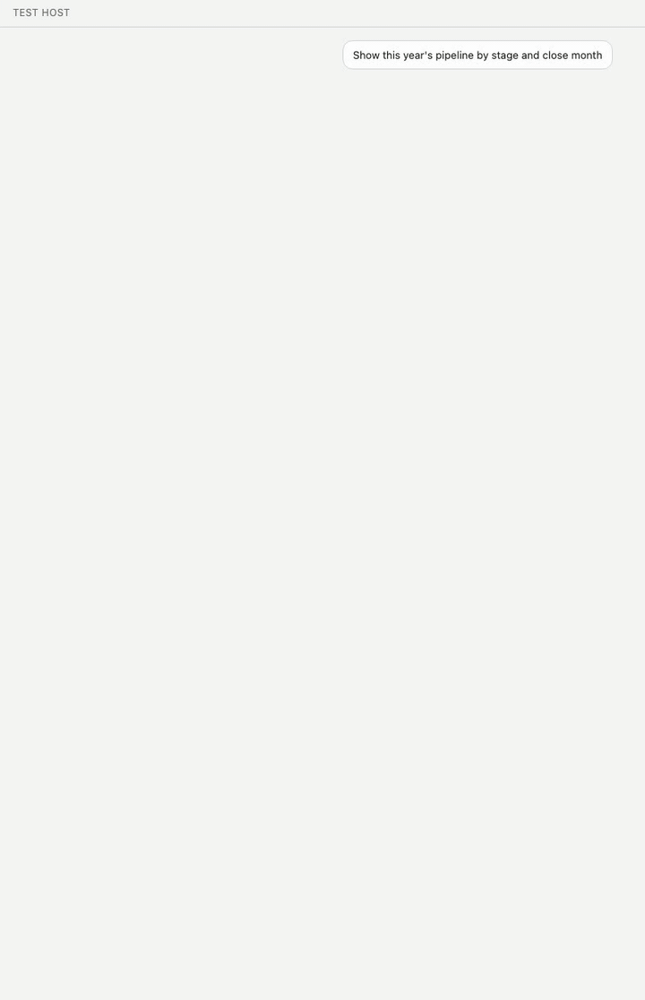
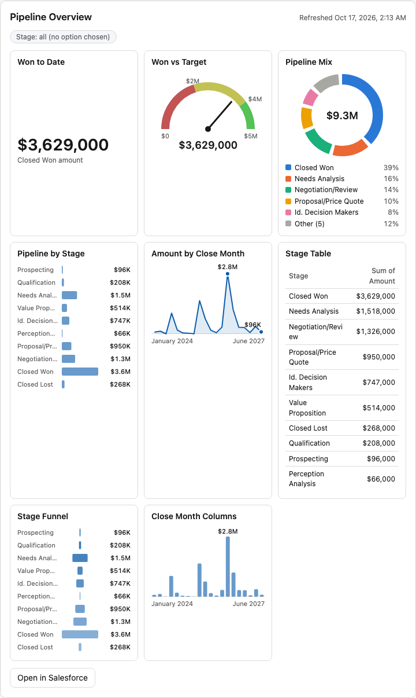

# salesforce-reports-mcp

[](https://github.com/nelsben/salesforce-reports-mcp/actions/workflows/ci.yml)

**Ask Salesforce a question in plain words. Get the answer, the chart and the caveats.**

Claude finds, builds, runs and saves Salesforce reports, and reads your dashboards, from a server on your own machine. Nothing is installed in Salesforce and no Salesforce MCP licence is needed. It works with the Salesforce login, API access and report permissions you already have, through the Salesforce CLI.

> **You:** I'm a seller. How is our pipeline looking this fiscal year? Is there anything I should worry about, and can you show it to me by owner too?
>
> **Claude:** $3.09M across 8 open opportunities, here by stage and by owner. Worries: one owner holds 91% of the dollars, one deal alone is 29% of the pipeline, nothing is closed won this fiscal year, and one deal has no amount. Salesforce applied its default probability filter. Nothing was saved; say the word and I will save it as a report.
>
> *A recorded Claude Code run through the local MCP server, on a small Developer Edition org ([rehearsal](docs/rehearsals/runner.md)).*



## The answers are in Salesforce. Most people cannot get them out.

**Reports are how a company answers questions about its customers and its pipeline, and most of the people who need those answers cannot build one.**

A seller wants a number, not Report Builder. An analyst wants to try three versions of a report before saving one. An admin wants a report in another org or in git. Today each of those is a ticket, a wait, or a spreadsheet export. Here each is a sentence typed to Claude.

## Three jobs, done by asking

**The person with the question gets the answer. No one waits on the one colleague who knows Report Builder.**

Each is a Claude skill, and Claude picks the right one from what you say.

| Skill | For | What Claude does |
| --- | --- | --- |
| [report-runner](skills/report-runner/SKILL.md) | A seller or manager who wants an answer | Finds the report, says in plain words what it counts, runs it, leads with the answer, offers the next slice. Never saves. |
| [report-designer](skills/report-designer/SKILL.md) | Someone who wants a report changed or made | Drafts the report in your words, previews it on real data, changes it until you like it, saves it in one step when you ask. |
| [report-deploy](skills/report-deploy/SKILL.md) | An admin moving a report between orgs or into git | Retrieves the report's metadata, checks it with a dry run, deploys only after you say yes. |

> **You:** Start from my Pipeline by Stage report. Add Next Step and group it by owner, then save it as Pipeline by Owner.
>
> **Claude:** Preview, with 8 deals under two owners. Saved as a new report in your Private Reports; the original is untouched. Link.

## Numbers you can repeat in a meeting

**Every answer says what was counted, what was filtered and what was left out, so nobody presents a number they cannot explain.**

Every run returns the same compact shape: the filters that were applied, including the ones Salesforce adds on its own, the groups and totals, and notes that say when rows were cut or Salesforce ignored part of the request. The [experiences page](docs/experiences.md) has the personas and the facts that shaped them. Nothing is saved or changed unless you ask, and a read-only mode removes every write.

## The answer arrives as a picture

**In Claude Desktop the result draws as a card in the chat: the headline, the filters, the groups and a button to save it.**

Salesforce dashboards draw the same way, every component as its own chart.



*Drawn by the [render test](docs/decisions/0014-render-tests-through-a-test-host.md)'s host page from anonymised test data.*

Claude can find a Salesforce dashboard, read the numbers Salesforce last cached and refresh it when the data is old.

## Then keep it as a Claude dashboard

**Ask for a dashboard, and Claude turns the report it just ran into a page you can keep and share.**

In one test on Claude Desktop for Windows in November 2026, a single request ran a pipeline report and built a page with four headline tiles, a chart by stage, the detail table and a note on what was counted, in under three minutes. The page is made with [Claude Data](https://support.claude.com/en/articles/17454700-get-started-with-claude-dashboards), Claude's own dashboard feature, so your Claude plan has to include it.

The page is a copy of the numbers as of the run, not a live view. Check it against the answer in the chat before you share it.

## What you need, and what you do not

**No new licence and no install in Salesforce. A person who can already run reports and use the Salesforce CLI can start asking.**

You need:

- Claude Code or Claude Desktop. The dashboard step also needs a Claude plan that includes [Claude Data](https://support.claude.com/en/articles/17454700-get-started-with-claude-dashboards).
- Node.js 20 or later.
- The [Salesforce CLI](https://developer.salesforce.com/tools/salesforcecli), signed in to your org.
- A Salesforce user with API access and the Run Reports permission, plus Create and Customize Reports to save a report.

If your company restricts API access or the Salesforce CLI, that is the question to take to your admin.

| It does not need | Because |
| --- | --- |
| A Salesforce MCP licence | The server talks to the Reports REST API that every org already has |
| Anything installed in the org | It runs on your machine |
| A separate integration user | It signs in as you, with the Salesforce CLI session you already have |
| New access rules | Every call runs as you, so sharing, folder access and field-level security apply as they do in Salesforce |
| A stored password or key | The session is read from the CLI when needed and never written anywhere |

## Run it on your own org

**Two commands, and Claude is working on your own data.**

Run them in Claude Code, with Node 20 and the Salesforce CLI signed in:

```
claude plugin marketplace add nelsben/salesforce-reports-mcp
claude plugin install salesforce-reports@salesforce-reports
```

That installs the three skills and the MCP server. Claude uses your Salesforce CLI default org. To pick another org, start Claude Code with `SF_ORG=<alias> claude`. To remove every tool that can save or change something, add `SF_REPORTS_READ_ONLY=1` the same way.

Then ask:

- "How is our open pipeline looking by stage, and what should I worry about?"
- "Start from my pipeline report, group it by owner and save it as a new report."
- "Build me a dashboard of that to share with my team."

For Claude Desktop, [docs/claude-desktop.md](docs/claude-desktop.md) is the full recipe: the config entry with the two paths that trip people up, how to check it works, the safety flags, and what each Claude surface, including mobile, can do with a local server. For claude.ai and your phone, [From claude.ai and your phone](docs/install.md#from-claudeai-and-your-phone) runs the same server over HTTP behind a tunnel. [docs/install.md](docs/install.md#the-local-mcp-server) has every option.

## Where your data goes

**Report data goes from your Salesforce org to your machine and into your Claude conversation. The server sends it nowhere else.**

- The server runs on your machine and calls only your own Salesforce org, as you. It has no analytics.
- What a report returns goes into your Claude conversation, under the terms of your Claude plan.
- Nothing is saved or changed in Salesforce unless you ask.
- A Claude dashboard is a copy of the numbers in your Claude account, private until you share it. Anyone you share it with sees those numbers, whatever their Salesforce access.

[Security and identity](docs/security.md#where-your-data-goes) has the detail.

## Limits

**Know these before a number goes on a slide.**

- A Claude dashboard is a copy as of the run, not a live view.
- The report card draws amounts with a dollar sign in every org, whatever the org's currency.
- Salesforce returns at most 2,000 detail rows per run and 100 columns per report. Every answer says when rows were cut.
- Joined reports are not supported.
- Salesforce allows 500 report runs per org per hour.
- Salesforce adds default filters to some report types. They are listed in every answer, so check them against your question.

[The reference](docs/reference.md#limits) has the full list.

## Go deeper

| Page | What it holds |
| --- | --- |
| [Field notes](docs/field-notes.md) | What else was built and tried: the four ways to connect, the feature inside Salesforce, how it was built and checked, and why |
| [Security and identity](docs/security.md) | Who each call runs as, what it can change, where your data goes, and how secrets are kept out |
| [Reference](docs/reference.md) | The tools, the result shape, the safety rails and the limits |
| [Decision records](docs/decisions/README.md) | Every design choice, with what it costs and what was turned down |

## Help

Questions and problems go to [GitHub Issues](https://github.com/nelsben/salesforce-reports-mcp/issues).

## License

MIT.
