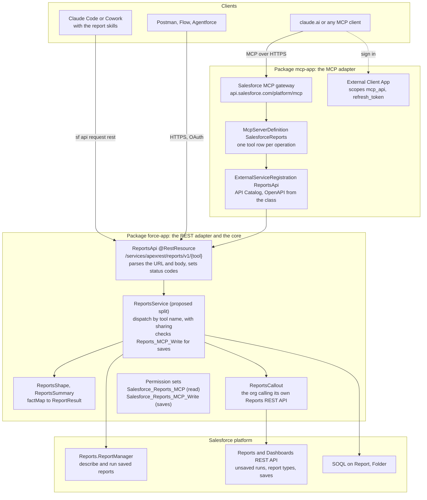
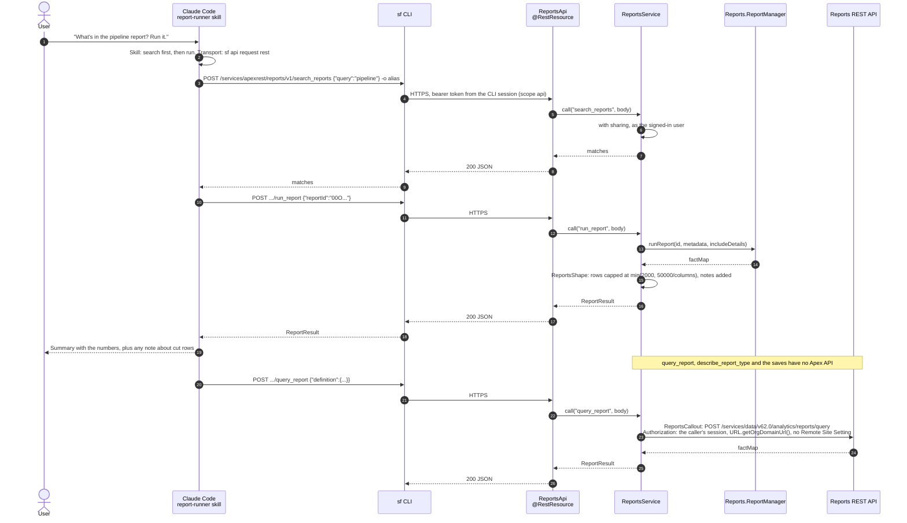
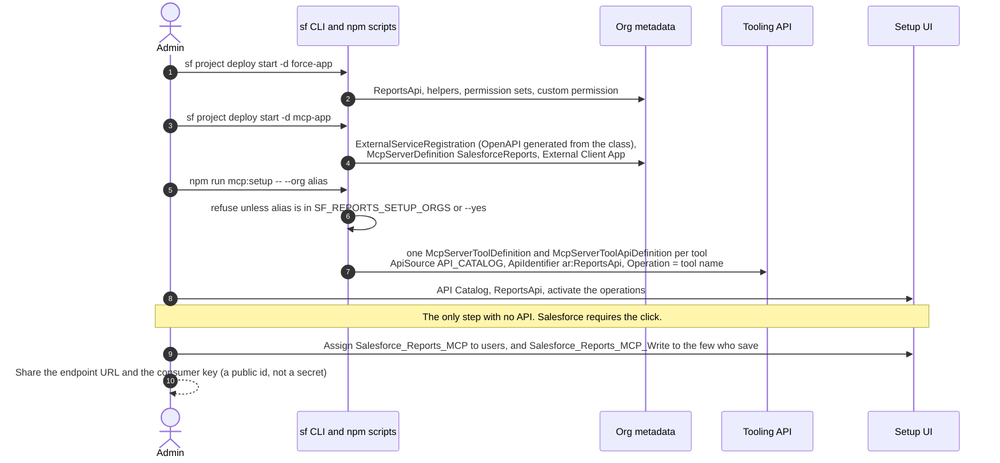
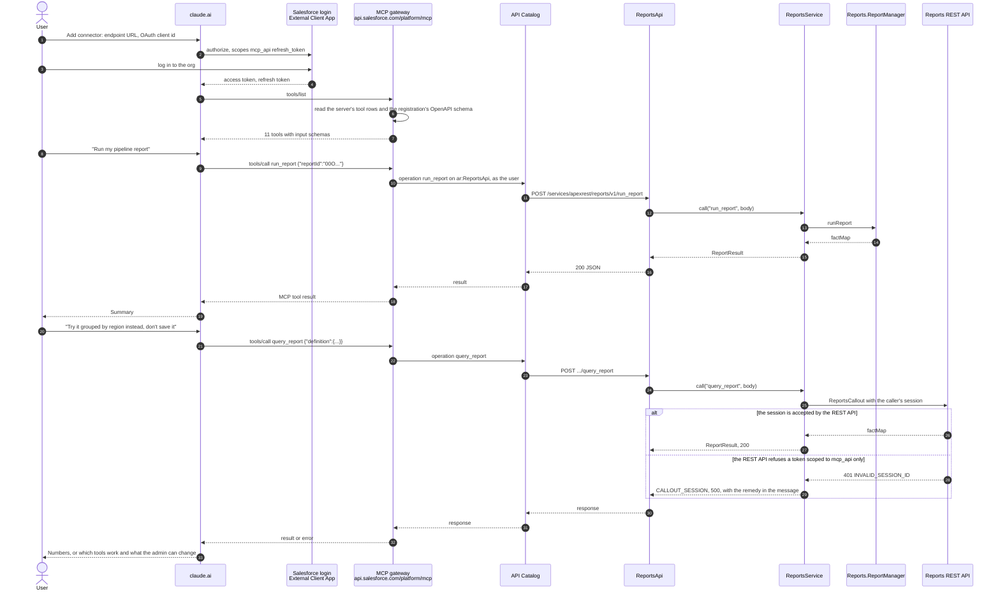
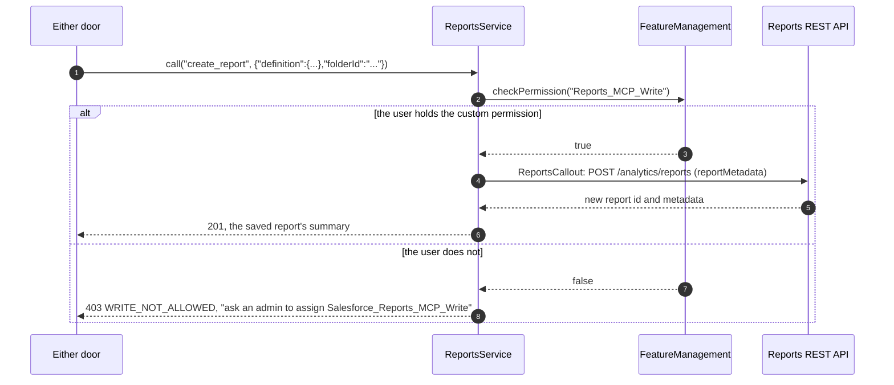

# Architecture

How the pieces fit, who calls what, and where each control lives. This page is the map; [design.md](design.md) is the contract for the tools, and `docs/decisions/` will hold the one-page records behind each choice.

Diagrams are Mermaid. GitHub renders them; VS Code needs a Mermaid preview extension.

## Three doors, one contract

Every door exposes the same tool names, takes the same `ReportDefinition` and returns the same `ReportResult`. The skills bind to tool names, never to a transport, so a skill written against one door works against the others.

| Door | Ships as | Who uses it | Runs where | Signs in with |
| --- | --- | --- | --- | --- |
| Local MCP server | npm package (v0.1) | Claude Desktop, Claude Code, any MCP client | the user's machine, Node 20+ | the `sf` CLI session or a token |
| In-org REST | Salesforce package `force-app` plus the skills | Claude Code and Cowork through the `sf` CLI; Postman, Flow HTTP callouts, Agentforce, any HTTP client | the Salesforce org | the caller's own Salesforce session |
| In-org hosted MCP | Salesforce package `mcp-app`, deployed on top of `force-app` | claude.ai, Claude Desktop, any MCP client with OAuth | Salesforce's MCP gateway, then the org | OAuth against the External Client App, scope `mcp_api` |

Nothing in the local server depends on the org packages. The hosted MCP door depends on the REST door, because Salesforce builds a custom MCP server from an API Catalog registration of an Apex REST class. That dependency is the platform's, not ours, and the layering below keeps it honest.

## Layers

Reading the diagram:

- The core never knows which door called it. `ReportsApi` is thin on purpose: URL, body, status code. Today the logic still lives inside `ReportsApi`; splitting `ReportsService` out is the one refactor this page proposes, so the adapter pattern is visible in the code and not only in the drawing.
- The MCP adapter adds no Apex. It is metadata (the registration, the server definition, the client app) plus a setup script that writes the tool rows. Removing it leaves the REST door untouched.
- Two platform routes exist for a reason. `Reports.ReportManager` runs saved reports with no callout and no extra scope. Unsaved runs, report types and saves have no Apex API, so they go through `ReportsCallout` to the Reports REST API as the signed-in user.

## Feature 1: the REST door with a skill

The skill tells Claude the tool names and when to use them. In Claude Code the transport is one `sf` command per call, so the signed-in user is the `sf` CLI user and the token carries the `api` scope. Callouts inside the org work without any extra setup.

What the user sees when something is refused:

| Case | Status | Body `code` | What the skill tells Claude to do |
| --- | --- | --- | --- |
| No permission set | 403 from the platform | none | Ask an admin for `Salesforce_Reports_MCP` |
| Save without the custom permission | 403 | `WRITE_NOT_ALLOWED` | Ask an admin for `Salesforce_Reports_MCP_Write`; offer the local server or the report builder meanwhile |
| Session cannot reach the REST API | 500 | `CALLOUT_SESSION` | Explain which tools still work (`search`, `folders`, `describe_report`, `run_report`) and point at the scope note below |
| Callout failed for another reason | 500 | `CALLOUT_FAILED` | Retry once, then report the message |

## Feature 2: the hosted MCP door

Two sequences: the admin sets it up once, then each user connects.

### Setup, once per org

### Runtime, per user

The `alt` block is the one open question in v0.2. It is answered by a sign-in to claude.ai and one call to `list_report_types`. Until then the design assumes the stricter branch, and the choice of fix is a decision record:

| Fix | Keeps the token narrow | Setup | Verdict |
| --- | --- | --- | --- |
| Add the `api` scope to the External Client App | No. The connector token can then call any REST API as the user | one setting | Documented opt-in for admins who want saves and unsaved runs in the hosted door |
| Named Credential, per-user principal | Yes | each user authorises once in My Settings | The alternative for orgs that will not widen the token |
| Named Credential, named principal | Yes, but reports would run as the integration user | one credential | Ruled out: the caller's sharing and field security would be lost |

## The write path, both doors

Why the tools stay listed for everyone on the hosted server: a tool list is not a security boundary. The REST door can be called directly, so the check has to live in the service regardless of what any client shows. One hosted server cannot hide tools per user, and a second write-only server would double the setup without adding a control. The tool descriptions say the permission is needed, and the 403 body tells Claude what to ask for.

There is no `delete_report` in the org. Deleting is left to the report builder and to the local server's `--allow-delete`.

## Security model

| Control | What it governs | Who sets it | Enforced by |
| --- | --- | --- | --- |
| Permission set `Salesforce_Reports_MCP` | who may call `ReportsApi` at all | admin | the platform (Apex class access) |
| Permission set `Salesforce_Reports_MCP_Write` with custom permission `Reports_MCP_Write` | who may create, update or clone | admin | `ReportsService`, before any callout |
| `with sharing`, running as the caller | which reports, folders, rows and fields a call can see | the org's existing sharing model | the platform |
| External Client App scopes `mcp_api`, `refresh_token` | what the hosted connector's token can reach | admin, at deploy | Salesforce OAuth |
| `SF_REPORTS_SETUP_ORGS` or `--yes` | which orgs the setup scripts will write to | the person running the script | the scripts, before any CLI call |
| No in-org delete | the one irreversible action | design | absence of code |

## Limits the design works within

| Limit | Value | How the design handles it |
| --- | --- | --- |
| Rows returned | `min(2000, floor(50000 / columns))` | capped in `ReportsShape`; `notes` says rows were cut |
| Synchronous Apex heap | 6 MB | heap guard before parsing a callout body; the row cap keeps factMaps small |
| Callouts per transaction | 100, 120 s total | at most three per tool call (save, then describe) |
| Apex CPU | 10 s | shaping is linear in rows; measured in `scripts/measure-query.apex` |
| API Catalog activation | Setup click only | documented as the one manual step |
| One hosted server, one tool list | no per-user tools | enforcement in the service, not the list |

## Shipping units

| Unit | Contents | Deploy | Depends on |
| --- | --- | --- | --- |
| `salesforce/force-app` | classes, tests, permission sets, custom permission | `sf project deploy start -d force-app` | nothing |
| `salesforce/mcp-app` | ExternalServiceRegistration, McpServerDefinition, External Client App; `npm run mcp:setup` | `sf project deploy start -d mcp-app`, then the script, then the Setup click | `force-app` |
| `skills/` | report-runner, report-designer, report-deploy; each names the tools and, in one short section, the three transports | upload to claude.ai, or install as a Claude Code plugin | any door |
| npm package | the local MCP server | `npm install -g` | nothing |

Open on this page, to settle before phase 3c:

1. Split `ReportsService` out of `ReportsApi`. Do it after phase 3b merges, so the saves land first and the refactor is a pure move with the parity check as the proof.
2. Move the MCP metadata from `force-app` into `mcp-app` and give each package its own manifest and README section.
3. One skill set with a transport section, or a separate REST skill. The recommendation is one set: skills bind to tool names.
