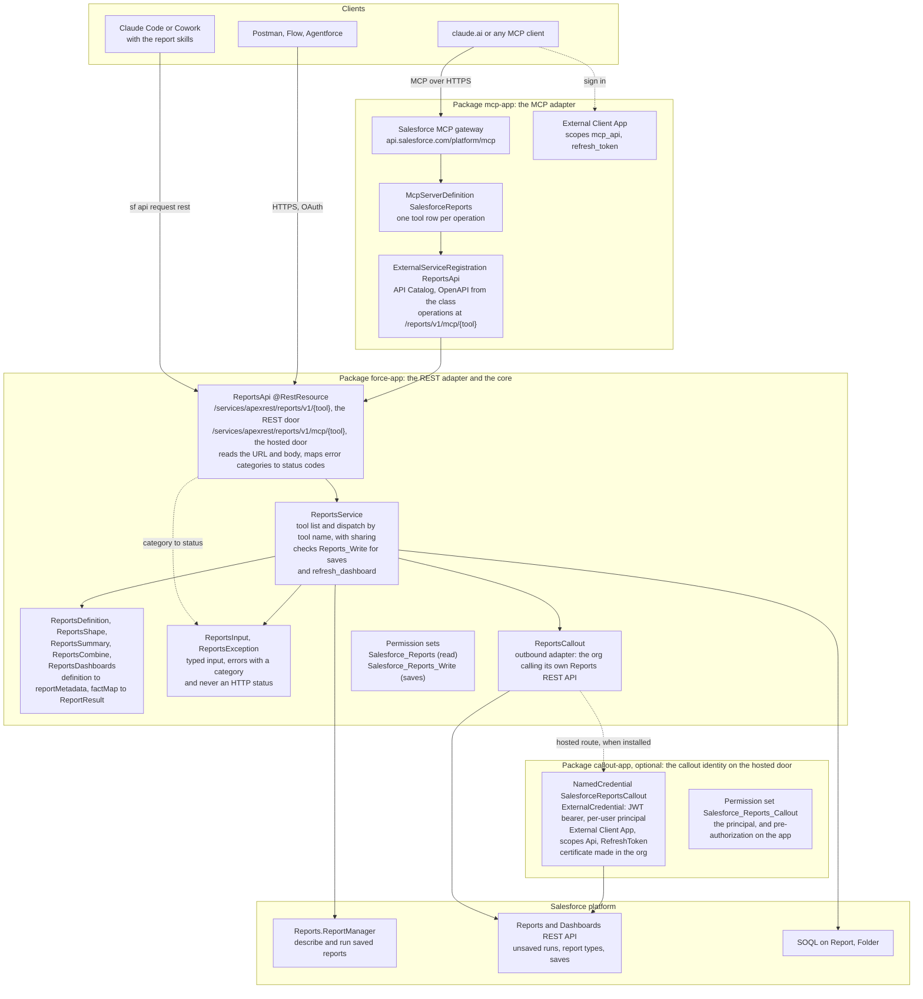
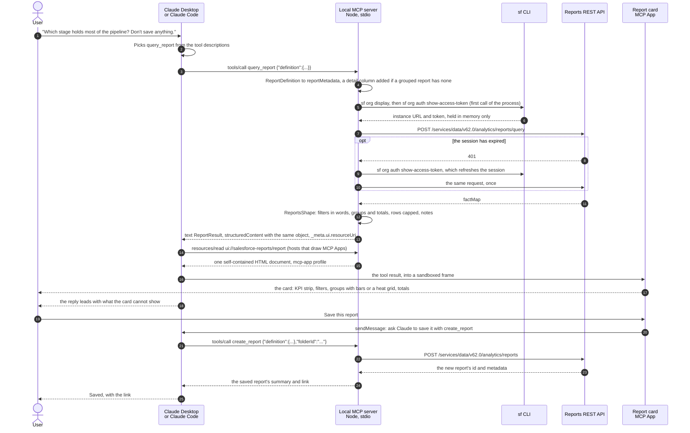
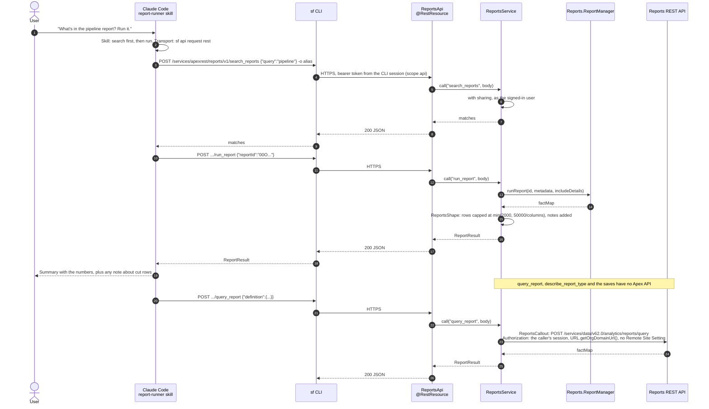
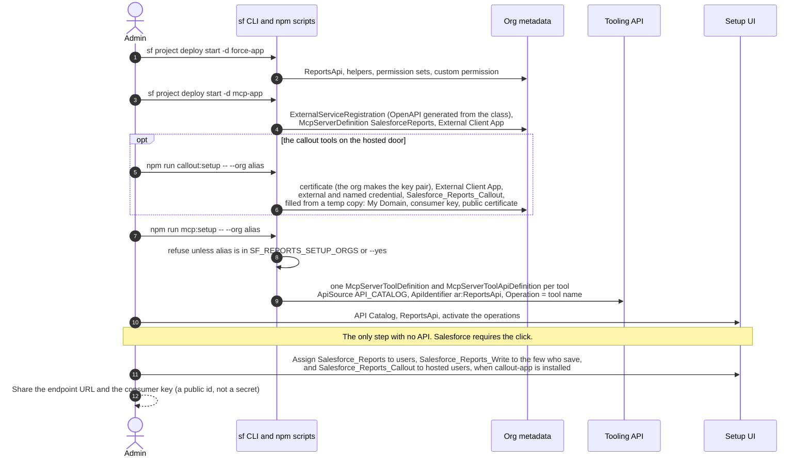
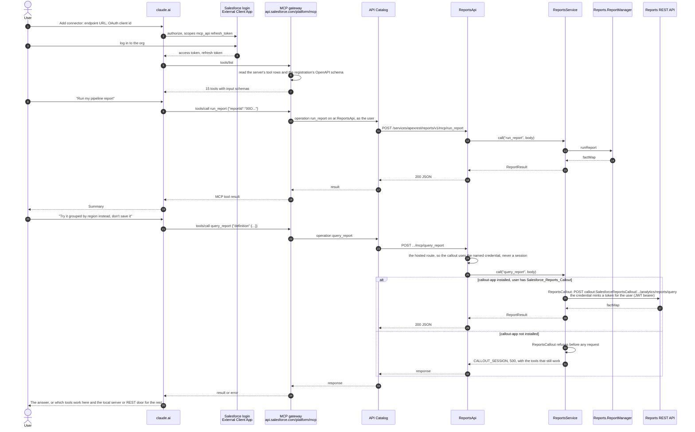
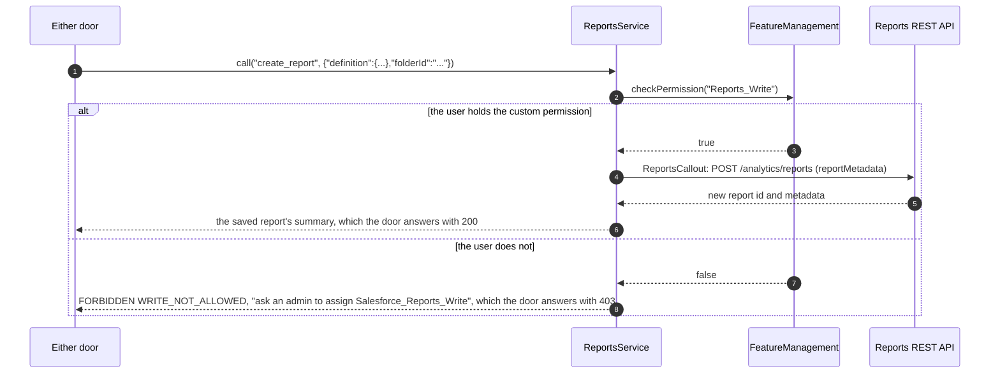

# Architecture

How the pieces fit, who calls what, and where each control lives. This page is the map; [design.md](design.md) is the contract for the tools, and `docs/decisions/` will hold the one-page records behind each choice.

Diagrams are Mermaid. GitHub renders them; VS Code needs a Mermaid preview extension. Each sequence diagram is numbered, and the table under it says what happens at each step and which decision record settled it.

## Three doors, one contract

Every door exposes the same tool names, takes the same `ReportDefinition` and returns the same `ReportResult`. The skills bind to tool names, never to a transport, so a skill written against one door works against the others.

| Door | Ships as | Who uses it | Runs where | Signs in with |
| --- | --- | --- | --- | --- |
| Local MCP server | npm package (v0.1) | Claude Desktop, Claude Code, any MCP client | the user's machine, Node 20+ | the `sf` CLI session or a token |
| In-org REST | Salesforce package `force-app` plus the skills | Claude Code and Cowork through the `sf` CLI; Postman, Flow HTTP callouts, Agentforce, any HTTP client | the Salesforce org | the caller's own Salesforce session |
| In-org hosted MCP | Salesforce package `mcp-app`, deployed on top of `force-app`, and optionally `callout-app` for the callout tools | claude.ai, Claude Desktop, any MCP client with OAuth | Salesforce's MCP gateway, then the org | OAuth against the External Client App, scope `mcp_api` |

Nothing in the local server depends on the org packages. The hosted MCP door depends on the REST door, because Salesforce builds a custom MCP server from an API Catalog registration of an Apex REST class. That dependency is the platform's, not ours, and the layering below keeps it honest.

The local door alone also carries a report view: `run_report` and `query_report` return their result as `structuredContent` too, with an MCP App resource, `ui://salesforce-reports/report`, that draws it as a report card in Claude Desktop, claude.ai and Cowork. The text result is unchanged, so Claude Code sees no difference. The in-org doors carry no view ([decision 0013](decisions/0013-report-view-as-an-mcp-app.md)). The third package, `callout-app`, is optional and holds no code: a per-user named credential that lets the hosted door call the org's own REST API as the user ([decision 0012](decisions/0012-per-user-jwt-named-credential.md)). `force-app` never depends on it.

## Layers

Reading the diagram:

- The core never knows which door called it. `ReportsApi` is thin on purpose: it reads the URL and the body, calls `ReportsService`, and maps an error's category to 400, 403, 404 or 500 with the error body. No core class names `ReportsApi`, and a core error carries a category (invalid input, forbidden, unknown tool, failed), never an HTTP status.
- `ReportsCallout` is the outbound adapter. It may read the upstream status codes of the Reports REST API, but it throws the core's `ReportsException`, so the core sees one error type whichever platform route failed.
- Each door has its own route on `ReportsApi`. The REST door posts to `/reports/v1/{tool}` and the callouts carry the caller's session. The hosted door's registration posts to `/reports/v1/mcp/{tool}`. A hosted sign-in gives Apex no session, and asking for one throws an exception no `catch` stops ([decision 0007](decisions/0007-callout-identity-under-hosted-mcp.md)). So on that route `ReportsApi` tells `ReportsCallout` to use the named credential instead, before it calls the core. With `callout-app` installed, each callout goes to `callout:SalesforceReportsCallout`, which mints a token for the running user. Without it, every callout answers `CALLOUT_SESSION` without asking for a session ([decision 0012](decisions/0012-per-user-jwt-named-credential.md)). The core still never knows which door called.
- The MCP adapter adds no Apex. It is metadata (the registration, the server definition, the client app) plus a setup script that writes the tool rows. Removing it leaves the REST door untouched.
- Two platform routes exist for a reason. `Reports.ReportManager` runs saved reports with no callout and no extra scope. Unsaved runs, report types and saves have no Apex API, so they go through `ReportsCallout` to the Reports REST API as the signed-in user.

## Door 1: the local MCP server with the report card

Nothing is installed in the org. The server runs on the user's machine, signs in with the user's own `sf` CLI session, and talks to the Reports REST API directly. `--read-only` removes every write tool, and `delete_report` exists only with `--allow-delete`. On hosts that draw MCP Apps, a run also appears as a report card.

| Steps | What happens |
| --- | --- |
| 1 to 3 | The user asks in plain words. The host picks `query_report` from the tool descriptions, since nothing is to be saved, and calls it over stdio. The description ends with the view hint, which tells Claude how to reply once a card is drawn. |
| 4 | The friendly `ReportDefinition` becomes Salesforce's `reportMetadata`. Salesforce rejects a grouped report with no detail column, so one is added from the type's defaults and a note says so ([live findings](design.md)). |
| 5 to 6 | Sign-in is the user's own `sf` CLI session. On the first call of the process the server reads the instance URL and token from the CLI (newer CLIs redact the token in `org display`, so it comes from `show-access-token`). The token stays in memory and never reaches a log, an error or stdout. `SF_INSTANCE_URL` and `SF_ACCESS_TOKEN` replace the CLI when set ([decision 0002](decisions/0002-local-server-needs-nothing-in-the-org.md)). |
| 7 to 10 | One request to the Reports REST API, as the user. On a 401 the server asks the CLI for a fresh token, which refreshes the session, and retries once. A second 401 is an error that says to log in again. |
| 11 to 12 | The raw factMap becomes a `ReportResult`: the filters in words, including the ones Salesforce adds on its own, groups with totals, detail rows capped at the row limit, and notes for anything cut or adjusted ([decision 0008](decisions/0008-result-limits.md)). |
| 13 | The result goes back twice: as text, byte for byte what the tool returned before the view existed, and as `structuredContent`. The tool's `_meta` names the view resource ([decision 0013](decisions/0013-report-view-as-an-mcp-app.md)). |
| 14 to 17 | A host that draws MCP Apps reads the view once per process and shows the result in a sandboxed frame. The document is self-contained and loads nothing from the network. Claude Code and other text-only hosts skip these steps and read the text ([decision 0015](decisions/0015-report-card-visuals.md) for what the card draws). |
| 18 | The reply leads with the one finding the card cannot show and never repeats the card's rows, totals or a table. |
| 19 to 25 | The card never calls a tool itself. Its Save button sends a chat message asking Claude to save with `create_report`, so the save is an explicit, visible tool call like any other, and the host asks for permission as it always does. |

## Door 2: the REST door with a skill

The skill tells Claude the tool names and when to use them. In Claude Code the transport is one `sf` command per call, so the signed-in user is the `sf` CLI user and the token carries the `api` scope. Callouts inside the org work without any extra setup.

| Steps | What happens |
| --- | --- |
| 1 to 2 | The user asks in Claude Code. The report-runner skill says: search before running, and on this door the transport is `sf api request rest`. |
| 3 to 4 | Each tool call is one `sf` command against the Apex REST route `/services/apexrest/reports/v1/<tool>`. The CLI sends the user's own session token, which carries the `api` scope. |
| 5 to 9 | `ReportsApi` reads the URL and body and hands the tool name and input to `ReportsService`, which runs `with sharing` as the signed-in user. The matches come back as 200 JSON. On the way out an error's category becomes 400, 403, 404 or 500 ([decision 0003](decisions/0003-one-apex-class-behind-both-in-org-doors.md)). |
| 10 to 12 | The second call runs the chosen report by id, through the same adapter. |
| 13 to 14 | A saved report runs through `Reports.ReportManager` inside the org: no callout, no extra scope, no session asked for ([decision 0004](decisions/0004-reportmanager-first-callout-for-the-rest.md)). |
| 15 | `ReportsShape` caps rows at `min(2000, 50000 / columns)` and adds notes ([decision 0008](decisions/0008-result-limits.md)). |
| 16 to 19 | The `ReportResult` travels back through the same layers, and Claude answers with the numbers plus any note about cut rows. |
| 20 to 26 | An unsaved report, the report type list and the saves have no Apex API. `ReportsCallout` posts to the org's own Reports REST API at `URL.getOrgDomainUrl()` with the caller's session. The org's own domain needs no Remote Site Setting. |

What the user sees when something is refused:

| Case | Status | Body `code` | What the skill tells Claude to do |
| --- | --- | --- | --- |
| No permission set | 403 from the platform | none | Ask an admin for `Salesforce_Reports` |
| Save without the custom permission | 403 | `WRITE_NOT_ALLOWED` | Ask an admin for `Salesforce_Reports_Write`; offer the local server or the report builder meanwhile |
| Session cannot reach the REST API | 500 | `CALLOUT_SESSION` | Explain which tools still work (`search`, `folders`, `describe_report`, `run_report`) and point at the scope note below |
| A callout tool on the hosted route, without `callout-app` | 500 | `CALLOUT_SESSION` | The same. No session is asked for and no callout is made |
| A callout tool on the hosted route, with `callout-app`, for a user without `Salesforce_Reports_Callout` | 500 | `CALLOUT_CREDENTIAL` | Ask an admin for `Salesforce_Reports_Callout`; the hint names it. Saved reports still work meanwhile |
| Callout failed for another reason | 500 | `CALLOUT_FAILED` | Retry once, then report the message |

## Door 3: the hosted MCP door

Two sequences: the admin sets it up once, then each user connects.

### Setup, once per org

| Steps | What happens |
| --- | --- |
| 1 to 2 | `force-app`: the Apex, its tests, the two permission sets and the custom permission. Complete on its own ([decision 0009](decisions/0009-two-shipping-units.md)). |
| 3 to 4 | `mcp-app`: the API Catalog registration, with OpenAPI generated from `ReportsApi` by `npm run mcp:generate`, the MCP server definition, and the External Client App Claude signs in through. No code. |
| 5 to 6 | Optional `callout-app`: the org makes its own key pair, and the script fills My Domain, the consumer key and the public certificate into a temp copy before deploying. The tracked files hold placeholders only, and a test keeps it that way ([decision 0012](decisions/0012-per-user-jwt-named-credential.md)). |
| 7 to 9 | `mcp:setup` writes one tool row per operation through the Tooling API. It refuses any org not named in `SF_REPORTS_SETUP_ORGS` unless `--yes` is passed. |
| 10 | The one step with no API: activating the operations in Setup. |
| 11 to 12 | Permission sets per role ([decision 0011](decisions/0011-name-permissions-for-the-capability.md)), then the endpoint URL and consumer key go to users. The consumer key is a public identifier, not a secret. |

### Runtime, per user

| Steps | What happens |
| --- | --- |
| 1 to 4 | The user adds the connector in claude.ai and signs in to the org. The token carries only `mcp_api` and `refresh_token`, so it cannot call the org's REST API on its own. |
| 5 to 7 | The gateway builds the tool list from the server's tool rows and the registration's OpenAPI schema: 15 tools, no delete ([decision 0006](decisions/0006-no-delete-in-the-org.md)). |
| 8 to 12 | A saved report run. The gateway calls the API Catalog operation as the user, which posts to the hosted route `/reports/v1/mcp/run_report`. |
| 13 to 19 | `Reports.ReportManager` runs it in the org. The result comes back through the same chain, and Claude summarises. |
| 20 to 25 | An unsaved report needs the Reports REST API. The route tells the code it was called by the hosted door, so it never asks for a session: under this sign-in, asking throws an exception Apex cannot catch ([decision 0007](decisions/0007-callout-identity-under-hosted-mcp.md)). |
| 26 to 29 | With `callout-app` installed and the user holding `Salesforce_Reports_Callout`, the per-user JWT named credential mints a token for the signed-in user and the callout runs. No secret is stored and no user clicks anything ([decision 0012](decisions/0012-per-user-jwt-named-credential.md)). |
| 30 to 32 | Without the package, the tool answers `CALLOUT_SESSION` before any request is made, and names the tools that still work. |
| 33 to 35 | Claude gives the answer, or explains which tools work here and offers the local server or the REST door for the rest, as the skill's fallback says. |

This was the one open question in v0.2, settled on 2026-10-12 ([decision 0007](decisions/0007-callout-identity-under-hosted-mcp.md)). Under the hosted sign-in, `UserInfo.getSessionId()` throws an exception Apex cannot catch, so the hosted route never asks for a session. Without `callout-app`, `list_report_types`, `query_report`, `combine_reports` with definitions and the three saves answer `CALLOUT_SESSION` there. `describe_report_type` reads the type through a saved report, and the other tools work as on the REST door. The fixes:

| Fix | Keeps the token narrow | Setup | Verdict |
| --- | --- | --- | --- |
| Add the `api` scope to the External Client App | No. The connector token can then call any REST API as the user | one setting | Untested: whether it stops the throw is not known |
| Named Credential, per-user principal, JWT bearer | Yes | one script per org, one permission set per user, no user click | Chosen and built as `callout-app` ([decision 0012](decisions/0012-per-user-jwt-named-credential.md)) |
| Named Credential, per-user principal, browser flow | Yes | each user authorises once in My Settings, and a consumer secret | Turned down for the JWT flow |
| Named Credential, named principal | Yes, but reports would run as the integration user | one credential | Ruled out: the caller's sharing and field security would be lost |

## The write path, both doors

| Steps | What happens |
| --- | --- |
| 1 to 2 | A save arrives from either door. Before any callout, the service asks `FeatureManagement` whether the user holds the custom permission `Reports_Write`, which comes with the permission set `Salesforce_Reports_Write` ([decision 0005](decisions/0005-saves-behind-a-custom-permission.md)). |
| 3 to 6 | With it, the definition becomes `reportMetadata` and is posted to the Reports REST API. The door answers 200 with the saved report's summary. |
| 7 to 8 | Without it, the service answers `FORBIDDEN` with `WRITE_NOT_ALLOWED` and the name of the permission set to ask for, which the door turns into 403. The check lives in the service, so calling the REST route directly changes nothing. |

Why the tools stay listed for everyone on the hosted server: a tool list is not a security boundary. The REST door can be called directly, so the check has to live in the service regardless of what any client shows. One hosted server cannot hide tools per user, and a second write-only server would double the setup without adding a control. The tool descriptions say the permission is needed, and the 403 body tells Claude what to ask for.

There is no `delete_report` in the org. Deleting is left to the report builder and to the local server's `--allow-delete`.

## Security model

| Control | What it governs | Who sets it | Enforced by |
| --- | --- | --- | --- |
| Permission set `Salesforce_Reports` | who may call `ReportsApi` at all | admin | the platform (Apex class access) |
| Permission set `Salesforce_Reports_Write` with custom permission `Reports_Write` | who may create, update or clone | admin | `ReportsService`, before any callout |
| `with sharing`, running as the caller | which reports, folders, rows and fields a call can see | the org's existing sharing model | the platform |
| External Client App scopes `mcp_api`, `refresh_token` | what the hosted connector's token can reach | admin, at deploy | Salesforce OAuth |
| `SF_REPORTS_SETUP_ORGS` or `--yes` | which orgs the setup scripts will write to | the person running the script | the scripts, before any CLI call |
| No in-org delete | the one irreversible action | design | absence of code |

## Limits the design works within

| Limit | Value | How the design handles it |
| --- | --- | --- |
| Rows returned | `min(2000, floor(50000 / columns))` | capped in `ReportsShape`; `notes` says rows were cut |
| Synchronous Apex heap | 6 MB | heap guard before parsing a callout body; the row cap keeps factMaps small |
| Callouts per transaction | 100, 120 s total | at most three per tool call (save, then describe) |
| Apex CPU | 10 s | shaping is linear in rows; measured in `scripts/measure-query.apex` |
| API Catalog activation | Setup click only | documented as the one manual step |
| One hosted server, one tool list | no per-user tools | enforcement in the service, not the list |

## Shipping units

| Unit | Contents | Deploy | Depends on |
| --- | --- | --- | --- |
| `salesforce/force-app` | classes, tests, permission sets, custom permission | `sf project deploy start -d force-app` | nothing |
| `salesforce/mcp-app` | ExternalServiceRegistration, McpServerDefinition, External Client App; `npm run mcp:setup` | `sf project deploy start -d mcp-app`, then the script, then the Setup click | `force-app` |
| `salesforce/callout-app` (optional) | certificate, External Client App, external credential, named credential, permission set `Salesforce_Reports_Callout`; placeholders only | `npm run callout:setup -- --org <alias>`, which fills a temp copy and deploys it | nothing to deploy; it is used by the hosted route of `force-app`, which runs without it |
| `skills/` | report-runner, report-designer, report-deploy; each names the tools and, in one short section, the three transports | upload to claude.ai, or install as a Claude Code plugin | any door |
| npm package | the local MCP server | `npm install -g` | nothing |

Removal runs the other way: `callout-app` (unassign its permission set, then the `manifest/callout-app` destructive deploy) and `npm run mcp:teardown` with the `manifest/mcp-app` destructive deploy first, then the `manifest/force-app` one. `salesforce/README.md` has the commands.

The reasons behind each choice on this page are in [docs/decisions/](decisions/README.md). Settled: one skill set, with the REST call form in each skill's `transport.md`.
