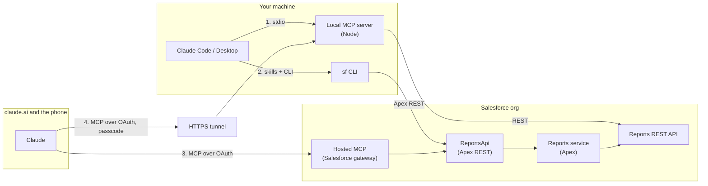

# Field notes

What else was built, tried and learned on the way to the short path in the [README](../README.md). Everything here is for the people who build, secure and run it.

This repo is working software, and a demonstration of how to put MCP in front of Salesforce without Salesforce's own MCP. The same tools are also packaged as a feature inside the org, for people who cannot run a local server, and every design choice is written down with what it costs. Built by [Ben Nelsen](https://github.com/nelsben).

## What this repo proves

**Four claims, each with evidence you can check yourself.**

| Claim | Where to look | Evidence you can check |
| --- | --- | --- |
| **1. MCP on Salesforce without Salesforce MCP**, from Claude Desktop and Claude Code, and from claude.ai and the phone through the same server over HTTP, plus two in-org doors for when a local server is not an option | [Four ways to connect](#four-ways-to-connect) | One tool contract and result shape on every door (16 tools locally, 15 in the org); a [parity check](decisions/0010-verification-by-parity.md) runs the same calls through two doors against a real org and compares them |
| **2. A useful feature added to Salesforce itself**, packaged the way an admin expects | [A feature inside Salesforce](#a-feature-inside-salesforce) | Three package directories; layered Apex with a CI test that fails if the layers leak; 90 Apex tests at 99% coverage |
| **3. Security, authentication and integration** done deliberately, per door | [Security and identity](security.md) | A different identity per door, a per-user JWT named credential with no stored secret, writes behind a custom permission, and a test that keeps org values out of the repo |
| **4. Product and architecture judgment**, shown in the work | [How it was built](#how-it-was-built) | Personas and [experiences](experiences.md), [7 probes](probes/) before building, [22 decision records](decisions/README.md), [live findings](design.md), [7 rehearsals](rehearsals/README.md) |

Door 4, the same server over HTTP for claude.ai and the phone, has passed on loopback only so far; [the install page](install.md#from-claudeai-and-your-phone) has the check.

## The gap, as of October 2026

As of October 2026, Salesforce's own Claude skills and its standard hosted MCP servers had no report tools, and the closest open-source servers could run or create a report, but none could change, clone or combine one, or run one that was never saved.

## The cards and dashboards

**A report card in the chat.** The report card in the README is an MCP App the local server carries with each run: the headline numbers, the filters, the groups with a bar beside each amount (or, for a matrix, a heat grid), the totals, a link to open it in Salesforce and, for an unsaved report, a button that asks Claude to save it. Claude's reply then leads with what the card cannot show instead of repeating it. The card loads nothing from the network, is styled with the Lightning Design System's own tokens so it reads as Salesforce ([decision 0018](decisions/0018-cards-follow-the-lightning-design-system.md)), and every heat cell passes WCAG AA contrast in light and dark. Clients that show only text, such as Claude Code, get the same result as text ([decision 0013](decisions/0013-report-view-as-an-mcp-app.md), [decision 0015](decisions/0015-report-card-visuals.md)). To keep or share a view, Claude can offer a Claude dashboard built from the result files of the runs. It is a copy as of the run and needs no tunnel or connector ([decision 0022](decisions/0022-dashboard-from-attached-result-files.md)). The skill tells Claude to say on the page that it is a copy and to give the run date, so check that the page says so before you share it.

**Dashboards, read and refreshed.** Claude can find a dashboard, describe its components and filters, read the numbers Salesforce last cached, and refresh it when the data is missing or old. A refresh counts as a write, so read-only mode leaves it out, and no tool saves a dashboard ([decision 0016](decisions/0016-dashboards-read-and-refresh-only.md)). In Claude Desktop the result draws as the dashboard card in the README, with every component as its own chart in the dashboard's layout ([decision 0017](decisions/0017-dashboard-card.md)).

## Four ways to connect

**One set of tools, four ways in. Pick the one your company's rules allow, and change later without retraining anyone.**

The local server is the lead: it is the whole product for anyone on Claude Code or Claude Desktop, and it needs nothing from Salesforce beyond an API session. The same server also runs over HTTP behind a tunnel, which is how it reaches claude.ai and the phone with nothing in the org and no Salesforce MCP. The same tools also reach Claude two more ways, for people who cannot run a local process: a seller on claude.ai, a Flow, an Agentforce agent. Those doors live inside the org as Apex. They differ in where the code runs, who hosts it and how the user signs in.



| | 1. Local MCP server | 2. In-org REST door with skills | 3. Hosted MCP door | 4. Local server over HTTP |
| --- | --- | --- | --- | --- |
| **Direction** | Claude reaches into Salesforce | Salesforce offers a feature; Claude calls it | Salesforce serves Claude directly | Claude reaches into Salesforce, from claude.ai and the phone |
| **Runs** | Node on your machine | Apex in the org | Salesforce's MCP gateway, then the same Apex | Node on your machine, behind an HTTPS tunnel |
| **Installed in the org** | Nothing | `force-app` | `force-app`, `mcp-app`, optionally `callout-app` | Nothing |
| **Signs in with** | Your `sf` CLI session or a token | Your own Salesforce session | OAuth with PKCE through an External Client App | The server's own OAuth with a passcode, then your `sf` CLI session |
| **Clients** | Claude Code, Claude Desktop, any MCP client | Claude Code and any agent with a shell; Flow, Agentforce, any HTTP client | claude.ai and any remote MCP client, with nothing to host | claude.ai and Claude mobile, one owner; checked on loopback only so far |
| **Tools** | All 16, including dashboards; delete only with a flag | 15, no delete | 15, no delete | All 16; delete only with a flag |
| **Choose it when** | You can run a process on your machine. No org change, no Salesforce MCP | An admin wants the feature in the org, used from scripts and agents | A team wants Claude in the browser, governed by the org | You want claude.ai or the phone with no org change and no Salesforce MCP, and can keep a machine up |

Each door gets the same tool names, the same input and the same result ([decision 0001](decisions/0001-one-contract-three-doors.md)). The skills bind to tool names, not to a door, so one skill works over all four. Door 4 acts as one Salesforce user, the one signed in on that machine ([decision 0020](decisions/0020-door-four-the-local-server-over-http.md)). [docs/architecture.md](architecture.md) has a numbered sequence diagram for each door, with every step explained.

## A feature inside Salesforce

**When a local server is not allowed, the same tools ship as a feature an admin installs and governs.**

The in-org doors are the same tools, rebuilt in Apex so they run where a local server cannot. They are a Salesforce feature an admin installs, not a script. They ship as three package directories in [salesforce/](../salesforce/README.md) ([decision 0009](decisions/0009-two-shipping-units.md)):

| Package | Holds | Needs |
| --- | --- | --- |
| `force-app` | The Apex service, its tests, two permission sets and a custom permission | Nothing else; complete on its own |
| `mcp-app` | The API Catalog entry, the MCP server definition and the External Client App Claude signs in through. No code. | `force-app` |
| `callout-app` | The per-user named credential that lets the hosted door call the org's own API as the user. No code. | `force-app`; used by the hosted door |

The Apex is layered as ports and adapters ([decision 0003](decisions/0003-one-apex-class-behind-both-in-org-doors.md)). One service does the work; the REST class is only an adapter, and [a test](../test/apex-layers.test.ts) fails CI if the core ever names it or sets an HTTP status. Reads use `Reports.ReportManager` inside the org; only what Apex cannot do (list report types, run an unsaved report, save) calls the org's own REST API ([decision 0004](decisions/0004-reportmanager-first-callout-for-the-rest.md)). There is no delete in the org ([decision 0006](decisions/0006-no-delete-in-the-org.md)).

## How it was built

**Every claim on this page has a test, a write-up or a recorded run behind it.**

The method was the same for every feature: probe the platform, decide in writing, build, then check against a real org.

| Step | What it produced |
| --- | --- |
| **Probe** before building | [7 probe write-ups](probes/): can a hosted MCP server wrap Apex, can Apex call its own org's API, how big a result fits in the heap, which identity works under a hosted sign-in, how dashboards refresh and filter |
| **Decide** in writing | [22 decision records](decisions/README.md), each with what it costs and what was turned down |
| **Build** to one contract | [design.md](design.md): the input and output shapes, and the live findings where Salesforce did not behave as documented |
| **Verify** against a real org | 306 unit and server tests, 24 render tests that draw the report and dashboard cards in a browser, 90 Apex tests, a live end-to-end check that leaves no report behind, and a parity check across doors; `npm run verify` runs all of it against one org and ends with one table of counts |
| **Rehearse** the experience | [7 rehearsals](rehearsals/README.md): real Claude runs of each skill on each door, with what went wrong and what changed |

## Why I built this

Most of what a company knows about its customers and its pipeline sits in Salesforce reports, and most of the people who need those answers cannot build a report. Assistants like Claude are becoming the way people ask, and the hard part is not the model: it is where the code runs, whose identity each call uses, and what it is allowed to change. I built this to work through those questions end to end for one real job, in the open, with every decision written down. The first answer is the local server, which needs nothing from Salesforce but an API session. The in-org packages show what it takes when that is not enough.

## Develop

```
npm install
npm run build
npm test
npm run test:render                            # draw the report card in Chromium and compare screenshots
npm run live -- --org <alias> --allow-delete   # end-to-end run against an org you can write to
npm run capture -- --org <alias>               # refresh the test fixtures (anonymised)
```

`npm run live` creates several private reports named `zz-live-check-*`, deletes them, and fails if any remain. Use a sandbox or scratch org.

## Roadmap

- Joined reports, report charts, and subscriptions.
